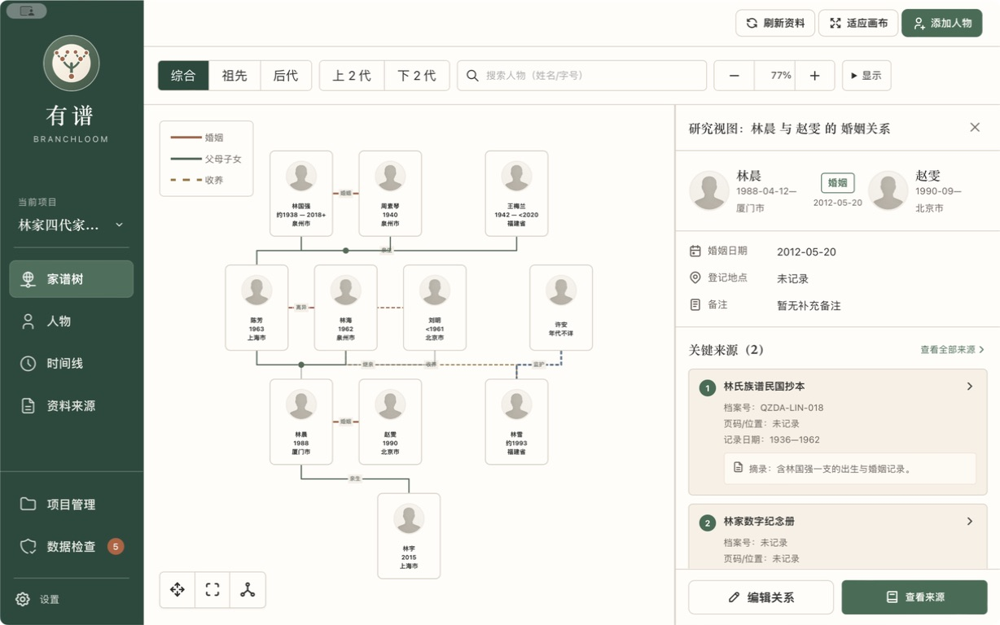

# Branchloom · 有谱

[简体中文](README.md) · English

Branchloom is a local-first genealogy and family archive app for macOS, Windows, Linux and Android. Bring people, relationships, events, places, historical sources and attachments together in one project, without creating an account.

[Download desktop and Android releases](https://github.com/tenlee2012/branchloom/releases) · [Open data format](DATA_FORMAT.md) · [CLI reference](packages/cli/README.md)



Screenshots use fictional demonstration records. Your own family records are stored locally by default.

## Interface languages

The interface supports English and Simplified Chinese. On first launch, Chinese system locales use Simplified Chinese; all other locales fall back to English.

On Linux, `LC_ALL`, `LC_MESSAGES` and `LANG` take precedence in that order. The `C` and `POSIX` locales use English. Other platforms and web development mode use the system or browser's primary language.

Use the language selector in the top bar, or in the project menu on narrow screens, to choose System default, 简体中文 or English. Save your edits before confirming: switching reopens the current page. The choice is a device preference and is kept outside project archives and synchronization data.

Names, notes, custom labels and original date text stay as entered. Interface language does not translate family records or change the existing Chinese genealogy PDF output.

## What you can do

- Manage multiple family archives and browse people through the family tree, person records and timeline.
- Record personal, courtesy, art, genealogy and other names, life dates, biographies, portraits and career histories.
- Preserve biological, adoptive, step, guardian and partner relationships. Explore kinship between two people, with explicit descriptions where the records do not establish a unique everyday term.
- Organize events, places, optional GPS coordinates, sources, quotations, citations and local attachments.
- Review data issues and possible duplicate people, and create manual snapshots.
- Import and export complete `.blp` project archives, including attachments. Exchange common person and family records with other genealogy software using GEDCOM 5.5, 5.5.1 and 7.0.
- Prepare modern books, traditional Chinese books and family charts as printable PDFs. The publication editor is bilingual; the existing PDF templates retain Chinese headings and typography.

## Optional family collaboration

Connect your own private GitHub repository to back up records and collaborate asynchronously with trusted family members. Branchloom previews changes, pulls before pushing and uses field-level three-way merges. Unresolved conflicts prevent uploads.

Each collaborator uses their own GitHub token. Desktop credentials are stored in the system credential store; Android keeps tokens only for the current app session. Tokens stay outside project records, `.blp` archives and sync baselines. Desktop can check for updates hourly while the app is running; Android uses manual sync.

GitHub collaboration is optional. Private repositories are not end-to-end encrypted storage, so share access only with trusted collaborators.

## AI tools

The desktop app bundles a matching native CLI and Codex Skill. Open **AI tools** to install, update, repair or uninstall them. End users do not need npm, npx or Node.js. Android does not provide CLI or Skill installation.

Writes require a preview and matching plan identifier; destructive operations require additional confirmation. See the [CLI documentation](packages/cli/README.md) for the machine protocol and isolated data directories.

## Development

Install the Node.js version required by `package.json`, pnpm 10.15.1 and the Rust toolchain, then run:

```bash
pnpm install
pnpm dev
```

Web development mode uses the shared Rust core through a local authenticated data bridge. For native desktop development with isolated test data:

```bash
BRANCHLOOM_DATA_DIR="$(mktemp -d)" pnpm tauri dev
```

The desktop data-directory override is supported in debug builds. Release builds use the platform's standard application data directory.

```bash
pnpm typecheck
pnpm test:unit
pnpm test:e2e
pnpm test:cli
cargo fmt --all -- --check
```

Use fictional or anonymized records in bug reports and tests. Do not upload real family records, private attachments or credentials. Deletion permanently removes business records; review the impact and confirmation before proceeding.

Branchloom is licensed under [Apache License 2.0](LICENSE). See [third-party notices](THIRD_PARTY_NOTICES.md) for bundled software licenses.
